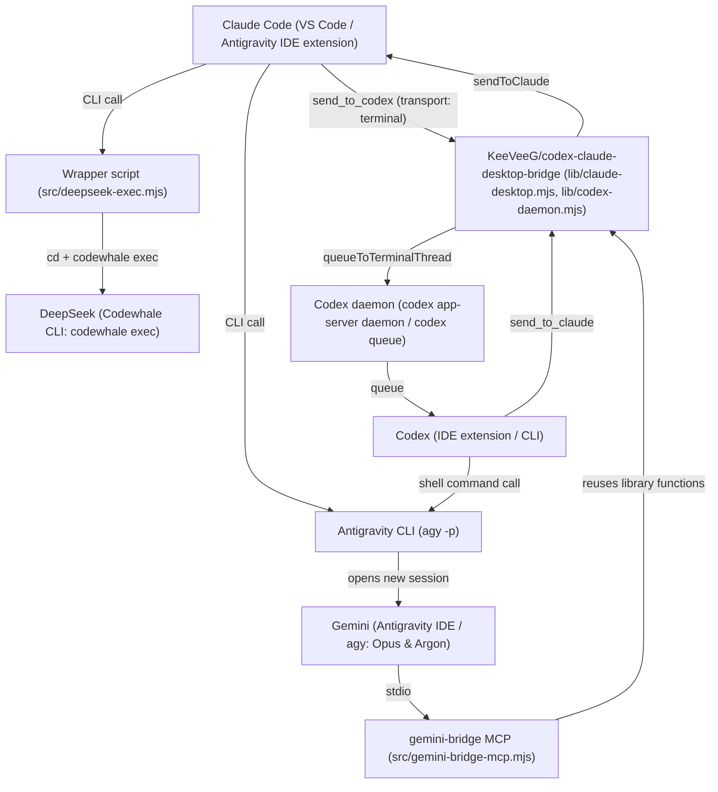

# ai-standalone-bridge

[Tiếng Việt](README.vi.md) | English

> **A personal setup, published as-is.** Many tools and applications already route coding agents to one another, so this repo is not a general-purpose solution and is not trying to compete with them. It is the maintainer's own standalone version of that wiring, kept public for reference. It was previously named `claude-codex-gemini-bridge` (now archived); this repo continues it under the new name and adds DeepSeek.

Documentation and supporting tools that let locally running coding agents - Claude Code (Anthropic), Codex (OpenAI), Gemini (Google, via Antigravity with Opus and Argon sessions), and DeepSeek (via the Codewhale CLI) - message or delegate tasks directly to one another without the user manually forwarding messages through the chat box. In this model, Claude Code acts as the coordinator, verifier, and direct contributor for work requiring user conversation context, while four execution sessions (Codex, Gemini Opus, Gemini Argon, and DeepSeek) take assigned tasks matched to their strengths or cover for one another when one side runs out of quota or balance.

## Tested status

Note upfront: All setup steps, source code, and instructions in this repo have only been tested on a single Windows machine.

Status labels: [VERIFIED] = actually run and observed; [REPORTED] = stated by the maintainer without logs in this repo; [NOT TESTED] = never tried. The Vietnamese originals under `docs/` use the Vietnamese labels (ĐÃ KIỂM = VERIFIED, BÁO CÁO = REPORTED, CHƯA KIỂM = NOT TESTED); the English translations under `docs/en/` use the English ones.

- **Tested environment ([VERIFIED])**: Windows 11 (single machine), Claude Code `2.1.312` (extension running in VS Code and in Antigravity IDE), Codex CLI `0.165.0` (installed via `npm`, with IDE extension), Antigravity CLI `agy` `1.4.10`, Codewhale CLI `0.10.2` (formerly `deepseek-tui`, installed via `npm`, default provider `deepseek`, default model `deepseek-flash` / DeepSeek V4.1 Flash and `deepseek-v4-pro`, plus the balance API `GET https://api.deepseek.com/user/balance`), Node `24.15`.
- **Untested environments ([NOT TESTED])**: macOS, Linux, other Windows machines, other IDEs, and multi-machine setups. The path to the bridge library has been parameterized (`BRIDGE_LIB_DIR` variable) and the test suite runs on machines without Claude, Codex, or Codewhale using a mock library and fake CLI script, but the installation instructions (PowerShell, `%LOCALAPPDATA%`, `%APPDATA%\npm`, Task Scheduler, `codex.exe`, `codewhale.cmd`) are still written for Windows. The upstream bridge's claimed macOS support over SSH and actual DeepSeek/Codewhale error responses when an account runs out of balance (HTTP `402`/`429`) have also not been observed directly ([NOT TESTED], inferred from API documentation).

## Communication directions and status

| Direction | Mechanism | Status |
|---|---|---|
| Claude -> Codex | Bridge `send_to_codex` tool, requires setting `transport: "terminal"` (or `codex exec`) | [VERIFIED] |
| Codex -> Claude | Bridge `send_to_claude` tool | [VERIFIED] |
| Gemini -> Claude | `send_to_claude` tool of the `gemini-bridge` MCP (or fallback script) | [VERIFIED] |
| Gemini -> Codex | `send_to_codex` tool of the `gemini-bridge` MCP (goes through `codex queue`) | [VERIFIED], exact timing of when Codex reads the message is unclear |
| Claude -> Gemini | `agy -p` command (opens a new non-interactive Gemini session) | [VERIFIED] |
| Codex -> Gemini | `agy -p` command run via Codex shell command | [VERIFIED] |
| Claude / Codex / Gemini -> DeepSeek | `codewhale exec` command (or via wrapper script `src/deepseek-exec.mjs`, opens a one-shot non-interactive execution session) | [VERIFIED] command invocation; live `402`/`429` balance exhaustion: [NOT TESTED] |

General limitations:
- No communication direction provides a read receipt (`acknowledged: false`).
- An already-open Gemini conversation in Antigravity IDE has no inbox for pushed messages; Gemini only receives tasks when invoked via `agy -p` or when it runs a tool itself.
- DeepSeek (Codewhale) has no channel for pushing messages into an already-open session and no MCP tool to send messages back through the bridge; it only receives one-shot tasks via `codewhale exec` and returns output on standard output (`stdout`).

## Architecture overview



## Coordination model and quota exhaustion handling

- **Coordination and role assignment**: Claude assigns suitable tasks across four execution sessions:
  - **Codex (`codex exec`)**: writing or modifying code, refactoring, running and fixing tests, reviewing diffs in a repo.
  - **Gemini Opus session (`agy`)**: hard reasoning, design, multi-step analysis, editing documentation and files outside the repo, deep review.
  - **Gemini Argon session (`agy`)**: broad research, reading long context, synthesis, drafting documentation, second opinions, cross-checking.
  - **DeepSeek (`codewhale exec`)**: 1M-token context window (up to 384K output), low cost; well suited for large-volume analysis or summarization, generating large amounts of code or documentation, and independent cross-checking. Tasks are assigned by `cd`-ing into the working directory before running `codewhale exec`, adding `--auto` when tools are needed (and `--sandbox workspace-write` when keeping the policy sandbox), and placing all flags before the prompt (using `--` if the prompt starts with `-`); for long prompts, write the prompt to a file and instruct it to read that file (or call `src/deepseek-exec.mjs`).
  - **Claude**: directly handles parts that require user conversation context, integration, independent result verification, and all restricted operations (writing to production or shared clusters, reading production DBs, write-capable `kubectl` or `ssh`, handling credentials, irreversible deletion, `push`, sending data externally, or changing agent permission settings).
- **Three collaboration patterns**: parallel task splitting, cross-checking (one session reviews another session's output), or sequential pipelines (Gemini/DeepSeek researches or analyzes, Codex or Claude implements, the remaining side reviews).
- **On quota or balance exhaustion**:
  - Codex and Gemini use time-windowed quotas; DeepSeek uses a monetary balance (queried via `GET https://api.deepseek.com/user/balance`, `[VERIFIED]`) and is treated as out of balance or rate-limited on HTTP `402` (`Insufficient Balance`) or `429` (inferred from API documentation, `[NOT TESTED]` on actual zero balance).
  - Failover order: if a limit is model-specific within the same tool, try a lower effort level of the same model first (in `agy`, for example `gemini-3.8-flash-medium`; Codewhale only offers `deepseek-flash` within the self-selectable range, so on balance exhaustion treat the session as exhausted rather than switching to `deepseek-v4-pro`). If the entire tool is out of quota or balance, transfer the task intact to a remaining execution session matched to the task's strengths (`Codex <-> Gemini (Opus/Argon) <-> DeepSeek`); if all sessions are exhausted, Claude performs the work itself and informs the user. Quota handoff between Codex and Gemini is currently at the `[REPORTED]` level; handoff involving DeepSeek on actual balance exhaustion is `[NOT TESTED]`.

## Directory structure

- `src/`:
  - `src/gemini-bridge-mcp.mjs`: Node `stdio` MCP server (no external dependencies) that provides Gemini with four tools - `list_claude_sessions`, `send_to_claude`, `list_codex_chats`, `send_to_codex` - by calling into the bridge library. `[VERIFIED: npm test passes on Windows with Node 24.15 (see Running tests); the live send test only runs when SESSION_ID and BRIDGE_LIB_DIR are manually set]`.
  - `src/gemini-send-to-claude.mjs`: Fallback CLI script to send a single message to a Claude session when not using MCP.
  - `src/deepseek-exec.mjs`: CLI wrapper around `codewhale exec` (accepts `--cwd`, `--prompt-file` or `--prompt`, `--auto`, `--sandbox`, `--model`, `--timeout`; automatically converts prompt files over 24,000 characters into a file-reading prompt; classifies results into `ok`, `quota_or_balance` for `402`/`429`, or `other_error`; refuses command-line API keys and redacts key patterns in output). `[VERIFIED: npm test passes using a fake codewhale on PATH]`.
- `test/`: Automated test suite for `gemini-bridge` and `deepseek-exec`; uses a mock bridge library in `test/fixtures/` and a fake `codewhale` script on `PATH` by default so it can run on machines without Claude, Codex, or Codewhale installed.
- `templates/`: Template block of agent coordination instructions (delimited by HTML tags `dieu-phoi-agent:bat-dau` and `dieu-phoi-agent:ket-thuc`) to be inserted into `<HOME>/.claude/CLAUDE.md`, `<HOME>/.codex/AGENTS.md`, and `<HOME>/.gemini/GEMINI.md`.
- `extras/redact-secrets/`: Optional `PostToolUse` hook for Claude Code that replaces secret strings in tool output with `<REDACTED:kind>`. `[VERIFIED: 12/12 tests, run live with PowerShell, Bash, Read, Grep]`; `[NOT TESTED]` with WebFetch, Agent, Glob, and MCP tools.
- `docs/`: Detailed documentation on setup, architecture, troubleshooting, and security. The Vietnamese originals are in `docs/`; the English translations are in `docs/en/`.

## Running tests

```
npm test
```

Requires Node >= 20, with no dependencies to install. Tested with Node 24.15 on Windows (45 tests, 44 passed, 1 skipped). The live message-sending test is skipped unless you manually set `SESSION_ID` and `BRIDGE_LIB_DIR` pointing to a real bridge. The CI workflow in `.github/workflows/test.yml` runs on Ubuntu, Windows and macOS with Node 20 and 22. It ran on 30 Oct 2026 on the initial 38-test suite, and all 6 combinations passed at least once across two runs on two commits whose code was identical (they differed only in the README). The macOS with Node 22 job was cancelled twice in the first run because GitHub could not allocate a macOS runner (an infrastructure error; the job ran no steps) and passed in the second run; the 7 new `deepseek-exec` tests have been run on Windows with Node 24.15 (`[NOT TESTED]` on macOS/Ubuntu CI). CI only tests logic using the mock library and fake script; it does not prove integration with real Claude, Codex, Gemini, or Codewhale installations, and the installation instructions have only been tried on Windows.

## Detailed documentation

The Vietnamese documents are the originals (maintained by hand). The English versions in `docs/en/` are translated from the Vietnamese text and checked for structure; if they ever disagree, the Vietnamese original is authoritative. Code comments, error messages, test names and the files under `templates/` are still in Vietnamese.

- Step-by-step installation and configuration guide: [docs/en/SETUP.md](docs/en/SETUP.md) ([Vietnamese](docs/SETUP.md))
- Architecture, message flows, identity, and coordination model: [docs/en/ARCHITECTURE.md](docs/en/ARCHITECTURE.md) ([Vietnamese](docs/ARCHITECTURE.md))
- Real-world errors encountered and how to fix them: [docs/en/TROUBLESHOOTING.md](docs/en/TROUBLESHOOTING.md) ([Vietnamese](docs/TROUBLESHOOTING.md))
- Trust model, permissions, and security: [docs/en/SECURITY.md](docs/en/SECURITY.md) ([Vietnamese](docs/SECURITY.md))

## Credits

This setup is based on the open-source project `KeeVeeG/codex-claude-desktop-bridge` (MIT license) by author KeeVeeG for connecting Claude Code and Codex. Release `v0.4.0` of the upstream bridge only recognized Claude sessions with entrypoints `claude-desktop`, `cli`, `sdk-cli`; support for the VS Code extension (`claude-vscode`) was submitted by us via PR #5 and merged into the `main` branch on `2026-10-29` (merge commit `3ac8488`). Because it is unclear whether a new release tag containing this patch exists yet, users need to install from the `main` branch starting from commit `3ac8488` onward.

This `ai-standalone-bridge` repo **does not contain the source code** of `KeeVeeG/codex-claude-desktop-bridge`, and only documents how to install it and load library functions from the `<bridge directory>/lib/` folder of that project.

## License

This project is released under the MIT license.
