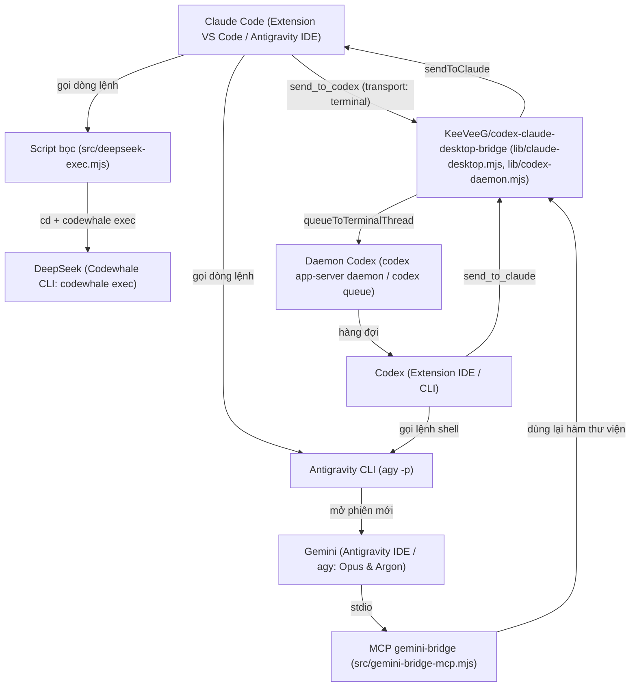

# ai-standalone-bridge

Tiếng Việt | [English](README.md)

> **Bản riêng của tác giả, công khai nguyên trạng.** Đã có nhiều công cụ và ứng dụng route các agent lập trình với nhau, nên repo này không phải giải pháp chung và không nhằm cạnh tranh với chúng. Đây là phiên bản độc lập của riêng tác giả cho phần nối này, để công khai tham khảo. Trước đây repo tên `claude-codex-gemini-bridge` (nay đã archive); repo này tiếp nối dưới tên mới và có thêm DeepSeek.

Tài liệu và bộ công cụ bổ trợ giúp các agent lập trình chạy cục bộ gồm Claude Code (Anthropic), Codex (OpenAI), Gemini (Google, qua Antigravity với phiên Opus và phiên Argon) và DeepSeek (qua Codewhale CLI) nhắn tin hoặc giao việc trực tiếp cho nhau mà không cần người dùng chuyển tiếp thủ công qua khung chat. Trong mô hình này, Claude Code giữ vai trò điều phối, kiểm chứng và trực tiếp làm phần việc cần ngữ cảnh hội thoại với người dùng, còn bốn phiên thực hiện (Codex, Gemini Opus, Gemini Argon, DeepSeek) nhận các phần việc được phân công theo thế mạnh hoặc thay thế nhau khi một bên hết quota hay hết số dư.

## Tình trạng kiểm nghiệm thực tế

Lưu ý ngay từ đầu: Toàn bộ thiết lập, mã nguồn và hướng dẫn trong repo này mới chỉ được kiểm nghiệm trên một máy Windows duy nhất.

- **Môi trường đã kiểm ([ĐÃ KIỂM])**: Windows 11 (một máy), Claude Code `2.1.312` (extension chạy trong VS Code và trong Antigravity IDE), Codex CLI `0.165.0` (cài bằng `npm`, có extension trong IDE), Antigravity CLI `agy` `1.4.10`, Codewhale CLI `0.10.2` (trước đây tên `deepseek-tui`, cài bằng `npm`, nhà cung cấp mặc định `deepseek`, model mặc định `deepseek-flash` / DeepSeek V4.1 Flash và `deepseek-v4-pro`, cùng API tra số dư `GET https://api.deepseek.com/user/balance`), Node `24.15`.
- **Môi trường chưa kiểm ([CHƯA KIỂM])**: macOS, Linux, máy Windows khác, các IDE khác và cấu hình nhiều máy. Đường dẫn tới thư viện của bridge đã được tham số hóa (biến `BRIDGE_LIB_DIR`) và bộ test chạy được trên máy không có Claude, Codex hay Codewhale nhờ thư viện và script giả, nhưng các hướng dẫn cài (PowerShell, `%LOCALAPPDATA%`, `%APPDATA%\npm`, Task Scheduler, `codex.exe`, `codewhale.cmd`) vẫn viết cho Windows. Tuyên bố hỗ trợ macOS qua SSH của bridge gốc và phản hồi lỗi thực tế của DeepSeek/Codewhale khi tài khoản cạn số dư (HTTP `402`/`429`) cũng chưa được quan sát trực tiếp ([CHƯA KIỂM], suy đoán từ tài liệu API).

## Các chiều liên lạc và trạng thái

| Chiều liên lạc | Cơ chế thực hiện | Trạng thái |
|---|---|---|
| Claude -> Codex | Công cụ `send_to_codex` của bridge, bắt buộc đặt `transport: "terminal"` (hoặc `codex exec`) | [ĐÃ KIỂM] |
| Codex -> Claude | Công cụ `send_to_claude` của bridge | [ĐÃ KIỂM] |
| Gemini -> Claude | Công cụ `send_to_claude` của MCP `gemini-bridge` (hoặc script dự phòng) | [ĐÃ KIỂM] |
| Gemini -> Codex | Công cụ `send_to_codex` của MCP `gemini-bridge` (đi qua `codex queue`) | [ĐÃ KIỂM], chưa rõ thời điểm phía Codex đọc tin |
| Claude -> Gemini | Lệnh `agy -p` (mở một phiên Gemini mới không tương tác) | [ĐÃ KIỂM] |
| Codex -> Gemini | Lệnh `agy -p` chạy qua lệnh shell của Codex | [ĐÃ KIỂM] |
| Claude / Codex / Gemini -> DeepSeek | Lệnh `codewhale exec` (hoặc qua script bọc `src/deepseek-exec.mjs`, mở phiên thực hiện một lần) | [ĐÃ KIỂM] gọi lệnh; lỗi `402`/`429` khi hết tiền thật: [CHƯA KIỂM] |

Giới hạn chung:
- Không chiều liên lạc nào có xác nhận đã đọc (`acknowledged: false`).
- Hội thoại Gemini đang mở sẵn trong Antigravity IDE không có hộp thư nhận tin đẩy vào; Gemini chỉ nhận việc khi được gọi bằng `agy -p` hoặc khi tự chạy công cụ.
- DeepSeek (Codewhale) không có kênh nhắn tin vào phiên đang mở và không có công cụ MCP gửi ngược qua bridge; chỉ nhận việc một lần qua `codewhale exec` và trả kết quả qua đầu ra chuẩn (`stdout`).

## Kiến trúc tổng quan



## Mô hình điều phối và xử lý hết quota

- **Điều phối và phân vai**: Claude phân công việc phù hợp cho bốn phiên thực hiện:
  - **Codex (`codex exec`)**: viết hoặc sửa mã, refactor, chạy và sửa test, review diff trong repo.
  - **Gemini phiên Opus (`agy`)**: lập luận khó, thiết kế, phân tích nhiều bước, sửa tài liệu và tệp ngoài repo, review sâu.
  - **Gemini phiên Argon (`agy`)**: tra cứu rộng, đọc ngữ cảnh dài, tổng hợp, soạn tài liệu nháp, ý kiến thứ hai, chéo kiểm.
  - **DeepSeek (`codewhale exec`)**: ngữ cảnh 1M token (đầu ra tối đa 384K), chi phí thấp; phù hợp cho phân tích hoặc tóm tắt khối lượng lớn, sinh mã hoặc tài liệu dài, chéo kiểm độc lập. Giao việc bằng cách `cd` vào thư mục làm việc trước khi gọi `codewhale exec`, thêm `--auto` khi cần công cụ (và `--sandbox workspace-write` khi cần giữ sandbox chính sách), đặt mọi cờ trước lời nhắc (dùng `--` nếu lời nhắc bắt đầu bằng `-`); lời nhắc dài thì ghi ra tệp rồi dặn đọc tệp (hoặc gọi qua `src/deepseek-exec.mjs`).
  - **Claude**: trực tiếp làm các phần cần ngữ cảnh hội thoại với người dùng, tích hợp, kiểm chứng độc lập và mọi thao tác thuộc nhóm hạn chế (ghi lên production hoặc cụm dùng chung, đọc DB production, `kubectl` hoặc `ssh` có ghi, xử lý credential, xóa không hoàn tác, `push`, gửi dữ liệu ra ngoài, đổi cấu hình quyền của agent).
- **Ba cách phối hợp**: chia việc song song, chéo kiểm (một phiên đọc lại kết quả của phiên khác), hoặc nối tiếp (Gemini/DeepSeek tra cứu hoặc phân tích, Codex hoặc Claude cài đặt, bên còn lại review).
- **Khi hết quota hoặc hết số dư**:
  - Codex và Gemini tính theo cửa sổ quota; DeepSeek tính theo số dư tiền (tra qua `GET https://api.deepseek.com/user/balance`, `[ĐÃ KIỂM]`) và được coi là hết tiền hoặc chạm giới hạn khi gặp lỗi HTTP `402` (`Insufficient Balance`) hoặc `429` (suy đoán từ tài liệu API, `[CHƯA KIỂM]` khi cạn tiền thật).
  - Thứ tự dự phòng: nếu lỗi giới hạn theo model trong cùng công cụ, thử model dự phòng trước (`deepseek-flash` <-> `deepseek-v4-pro` trong Codewhale; đổi model tương đương trong `agy`). Nếu cả công cụ hết quota hoặc hết số dư, chuyển nguyên vẹn phần việc sang phiên thực hiện còn lại theo thế mạnh (`Codex <-> Gemini (Opus/Argon) <-> DeepSeek`); nếu tất cả đều hết, Claude tự thực hiện và báo cho người dùng. Việc chuyển giao giữa Codex và Gemini khi hết quota hiện ở mức `[BÁO CÁO]`; chuyển giao có DeepSeek ở mức `[CHƯA KIỂM]` với lỗi hết tiền thật.

## Cấu trúc thư mục

- `src/`:
  - `src/gemini-bridge-mcp.mjs`: Máy chủ MCP giao tiếp qua `stdio` viết bằng Node (không dùng phụ thuộc ngoài), cung cấp cho Gemini bốn công cụ `list_claude_sessions`, `send_to_claude`, `list_codex_chats`, `send_to_codex` bằng cách gọi lại thư viện của bridge. `[ĐÃ KIỂM: npm test đạt trên Windows với Node 24.15 (xem mục Chạy kiểm thử); ca gửi thật chỉ chạy khi tự đặt SESSION_ID và BRIDGE_LIB_DIR]`.
  - `src/gemini-send-to-claude.mjs`: Script dòng lệnh dự phòng để gửi một tin tới phiên Claude khi không dùng MCP.
  - `src/deepseek-exec.mjs`: Script dòng lệnh bọc `codewhale exec` (nhận `--cwd`, `--prompt-file` hoặc `--prompt`, `--auto`, `--sandbox`, `--model`, `--timeout`; tự chuyển tệp lời nhắc dài quá 24.000 ký tự thành lời nhắc đọc tệp; phân loại kết quả thành `ok`, `quota_or_balance` cho `402`/`429`, hoặc `other_error`; từ chối nhận khóa API qua dòng lệnh và tự che mẫu khóa trong đầu ra). `[ĐÃ KIỂM: npm test đạt với codewhale giả trên PATH]`.
- `test/`: Bộ kiểm thử tự động cho `gemini-bridge` và `deepseek-exec`; mặc định dùng thư viện bridge giả trong `test/fixtures/` và script `codewhale` giả trên `PATH` nên chạy được ở máy không cài Claude, Codex hay Codewhale.
- `templates/`: Mẫu khối hướng dẫn điều phối agent (kẹp giữa hai thẻ HTML `dieu-phoi-agent:bat-dau` và `dieu-phoi-agent:ket-thuc`) dùng để chèn vào `<HOME>/.claude/CLAUDE.md`, `<HOME>/.codex/AGENTS.md` và `<HOME>/.gemini/GEMINI.md`.
- `extras/redact-secrets/`: Hook `PostToolUse` tùy chọn cho Claude Code giúp thay thế các chuỗi bí mật trong đầu ra công cụ bằng `<REDACTED:loại>`. `[ĐÃ KIỂM: 12/12 test, chạy thật với PowerShell, Bash, Read, Grep]`; `[CHƯA KIỂM]` với WebFetch, Agent, Glob và công cụ MCP.
- `docs/`: Tài liệu chi tiết về cài đặt, kiến trúc, xử lý sự cố và bảo mật (bản gốc tiếng Việt); bản dịch tiếng Anh nằm ở `docs/en/`.

## Chạy kiểm thử

```
npm test
```

Cần Node >= 20, không có phụ thuộc cần cài. Mới chạy với Node 24.15 trên Windows (45 test, 44 đạt, 1 bỏ qua). Ca gửi tin thật bị bỏ qua trừ khi bạn tự đặt `SESSION_ID` và `BRIDGE_LIB_DIR` trỏ tới bridge thật. Workflow CI trong `.github/workflows/test.yml` (Ubuntu, Windows, macOS với Node 20 và 22) đã chạy ngày 30/10/2026 trên bộ 38 test ban đầu và cả 6 tổ hợp (Ubuntu, Windows, macOS với Node 20 và 22) đều đạt ít nhất một lần, qua hai lượt chạy trên hai commit chỉ khác nhau ở README (mã giống hệt). Riêng tổ hợp macOS với Node 22 bị hủy hai lần ở lượt đầu vì GitHub không cấp được máy chạy macOS (lỗi hạ tầng, job chưa chạy bước nào) rồi đạt ở lượt sau; 7 test mới của `deepseek-exec` mới chạy trên Windows với Node 24.15 (`[CHƯA KIỂM]` trên CI macOS/Ubuntu). CI chỉ kiểm logic bằng thư viện và script giả, không chứng minh tích hợp với Claude, Codex, Gemini hay Codewhale thật; các hướng dẫn cài đặt vẫn chỉ được thử trên Windows.

## Tài liệu chi tiết

Bản tiếng Việt là bản gốc (viết và duy trì chính). Bản tiếng Anh trong `docs/en/` được dịch từ bản tiếng Việt và đối chiếu cấu trúc; nếu hai bản khác nhau thì lấy bản tiếng Việt. Chú thích trong mã, thông báo lỗi, tên test và các tệp trong `templates/` vẫn bằng tiếng Việt.

- Hướng dẫn cài đặt và cấu hình từng bước: [docs/SETUP.md](docs/SETUP.md) ([English](docs/en/SETUP.md))
- Kiến trúc, luồng tin nhắn, danh tính và mô hình điều phối: [docs/ARCHITECTURE.md](docs/ARCHITECTURE.md) ([English](docs/en/ARCHITECTURE.md))
- Các lỗi thực tế đã gặp và cách khắc phục: [docs/TROUBLESHOOTING.md](docs/TROUBLESHOOTING.md) ([English](docs/en/TROUBLESHOOTING.md))
- Mô hình tin cậy, phân quyền và bảo mật: [docs/SECURITY.md](docs/SECURITY.md) ([English](docs/en/SECURITY.md))

## Ghi công

Thiết lập này dựa trên dự án mã nguồn mở `KeeVeeG/codex-claude-desktop-bridge` (giấy phép MIT) của tác giả KeeVeeG để kết nối giữa Claude Code và Codex. Bản phát hành `v0.4.0` của bridge gốc chỉ nhận các phiên Claude có entrypoint `claude-desktop`, `cli`, `sdk-cli`; hỗ trợ cho extension VS Code (`claude-vscode`) đã được chúng tôi gửi qua PR #5 và merge vào nhánh `main` ngày `2026-10-29` (commit merge `3ac8488`). Do chưa rõ đã có tag phát hành mới chứa bản vá này hay chưa, người dùng cần cài từ nhánh `main` tính từ commit `3ac8488` trở đi.

Repo `ai-standalone-bridge` này **không chứa mã nguồn** của `KeeVeeG/codex-claude-desktop-bridge`, mà chỉ hướng dẫn cách cài đặt và nạp lại các hàm thư viện từ thư mục `<thư mục bridge>/lib/` của dự án đó.

## Giấy phép

Dự án này được phát hành theo giấy phép MIT.
